# Lab 2 — Relatório individual

Nome: João Rietra  
Turma: BD-P4-2026.2  
Link do repositório: https://github.com/jhlr/wine

Este relatório responde ao enunciado do Lab 2 (`ENUNCIADO.pdf`). Todos os números vêm de arquivos de `resultados/`, gerados pela execução do `lab02.ipynb`. Quando um resultado foi pequeno ou desfavorável, eu escrevo isso do jeito que saiu. Os gráficos (seção "Gráficos") trazem a conclusão no título, gerada dos dados.

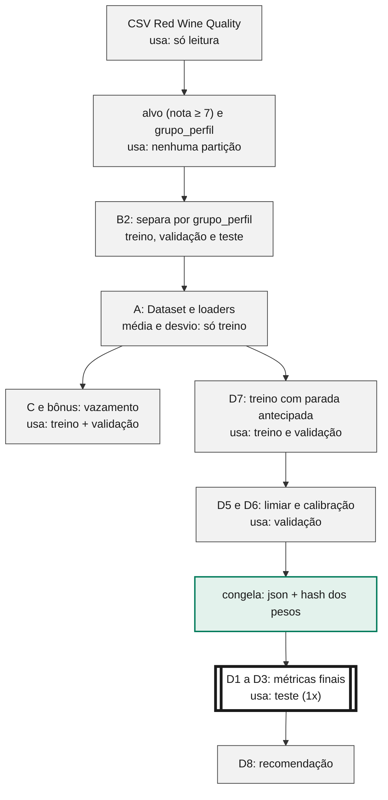

## Reprodução
**Ambiente.** Python 3.11.15 (Homebrew). Bibliotecas: numpy 2.4.6, pandas 3.0.6, scikit-learn 1.9.1, matplotlib 3.11.2, torch 2.14.1, mlflow 3.17.1, jupyterlab 4.6.4, ipykernel 7.4.0, nbconvert 7.17.2 (mais scipy, para o teste de Kolmogorov-Smirnov). Sistema: macOS 26.6.2 (Darwin 25.6.0). Equipamento: Apple M1, 8 núcleos lógicos, 4 threads do torch, só CPU (`'cpu'`). Semente global: **42** (`apoio.fixar_semente`). Acrescentei só `mlflow>=3,<4` e `scipy>=1.11,<2` ao `requirements.txt` original.

**Estrutura.** A raiz deste repositório é a pasta `lab-02/` da entrega (README, notebook, `USO-DE-IA.md`, `apoio.py`, `requirements.txt`, `dados/`, `resultados/`, o pacote `lab02lib/` e `mypy.ini`).

**Sequência de comandos** (a partir da raiz; o `.venv` fica no `.gitignore`):
```bash
python3.11 -m venv .venv
.venv/bin/python -m pip install -r requirements.txt
.venv/bin/python -m ipykernel install --sys-prefix --name lab02
PATH=".venv/bin:$PATH" .venv/bin/python -m jupyter nbconvert --to notebook --execute --inplace lab02.ipynb \
    --ExecutePreprocessor.timeout=1800 --ExecutePreprocessor.kernel_name=lab02
```
O `PATH` com o `bin` do ambiente é necessário porque `python -m jupyter nbconvert` chama o `jupyter-nbconvert` que estiver no `PATH`. A execução completa leva cerca de 45 segundos. O aviso "Kernel is running over TCP without encryption" vem do Jupyter. O código passa em `mypy lab02lib` sem erros.

**`apoio.py` não foi modificado** (SHA-256 `f6af5d69d886d8a9f471001303d246d7bda75645f7ba244fc40482246c6e6a78`). Todo o código novo está em `lab02lib/`.

**Mapa do código.**

| Item | Implementação | Arquivo |
|---|---|---|
| B2 | `particionar_sem_vazar`, `auditar_particoes` | [lab02lib/split.py](lab02lib/split.py) |
| A1, A2 | `MeuDataset`, `criar_datasets`, `criar_loaders`, verificações | [lab02lib/data.py](lab02lib/data.py) |
| A3 | `medir_tempos`, `resumir_tempos` | [lab02lib/timing.py](lab02lib/timing.py) |
| A4 | `demonstrar_batchnorm` | [lab02lib/batchnorm.py](lab02lib/batchnorm.py) |
| C (formas 1 e 4) | `executar_forma1`, `executar_forma4`, `resumir_c` | [lab02lib/leakage.py](lab02lib/leakage.py) |
| Bônus | `executar_bonus` | [lab02lib/bonus.py](lab02lib/bonus.py) |
| D7 | `treinar_com_parada`, `verificar_restauracao` | [lab02lib/train.py](lab02lib/train.py) |
| D4, D5, D6 | custos, `buscar_limiar`, fórmula, calibração, `congelar` | [lab02lib/decision.py](lab02lib/decision.py) |
| D1, D2, D3 | `avaliar_teste`, `EscoresUmaVez` | [lab02lib/evaluate.py](lab02lib/evaluate.py) |
| Todos os gráficos e a auditoria da paleta | `grafico_*`, `publicar`, `auditar_paleta` | [lab02lib/graficos.py](lab02lib/graficos.py) |
| MLflow (opcional) | registro em `mlflow.db` | [lab02lib/tracking.py](lab02lib/tracking.py) |

`LAB02_TRACKING=0` desliga o MLflow (um único `mlflow.db`, ignorado pelo git). As tabelas e figuras de `resultados/` são a evidência da entrega.

**Quem vê o quê** (o teste só aparece no fim):

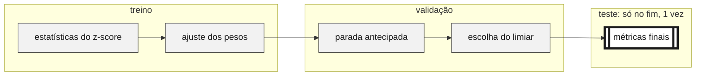

## Base e definição do alvo
**Fonte:** Red Wine Quality (Cortez et al., 2009), cópia da UCI (CC BY 4.0), detalhes em `dados/FONTE-E-LICENCA.md`. O CSV tem 1599 linhas, 11 medidas físico-químicas e a nota `quality`; o SHA-256 é conferido em `carregar_base`. **Alvo:** `quality >= 7` (classe 1): 217 positivos, 13,57% das linhas. **Unidade de observação:** uma amostra de vinho tinto. **Características:** só as 11 de `apoio.FEATURES`; `quality`, `alvo`, `id_linha` e `grupo_perfil` ficam fora (há `assert` no notebook e no `MeuDataset`).

**Limitações.** A fronteira 7 é convenção do laboratório. Há linhas com as mesmas 11 medidas, por isso `grupo_perfil` (hash das 11 medidas) mantém perfis idênticos juntos; perfis iguais não provam o mesmo vinho físico. A base não traz data, produtor nem região: não dá para avaliar tempo futuro, produtores novos ou outros domínios.

## B1 — Cinco cenários
**1. Avaliações de produtos.** Pressuponho que o modelo vai classificar avaliações de **usuários novos**. Então separo por usuário (`GroupShuffleSplit` com o id do autor). Num sorteio aleatório, as avaliações do mesmo usuário caem nos dois lados, e o estilo dele atravessa a fronteira: vocabulário, hábito de dar nota máxima, tamanho do texto. O modelo aprenderia o autor e não o produto. Se o uso fosse só para usuários já conhecidos, o sorteio aleatório seria defensável, e eu diria isso. Hipótese: não sei se há data nem produto; com produto, eu olharia também esse eixo.

**2. Turbinas.** O uso é prever falha nas próximas 24 horas, então o teste tem de ser o futuro: separo por ordem do tempo dentro de cada turbina (treino no começo, validação depois, teste no fim), com uma folga de 24 h entre os blocos. Num sorteio, o minuto t vai para o treino e o minuto t+1 para o teste, e janelas de 24 h que se sobrepõem repetem a mesma falha em muitas linhas. Preciso decidir o que "futuro" quer dizer: mesmas turbinas em tempo novo (bloco de tempo), turbinas novas (grupo por turbina) ou os dois. Hipótese: sem essa decisão, assumo tempo novo nas mesmas turbinas e declaro o limite.

**3. Spam.** Com 200 mil e-mails e 3% de spam, a divisão aleatória **estratificada** é defensável: mantém os 3% em cada conjunto e há muitos exemplos. A ressalva é que e-mails de uma mesma campanha, ou de uma mesma conversa, são quase cópias, e o sorteio os espalha pelos conjuntos. Se houver remetente, campanha ou thread, agrupo por eles. Se o spam muda com o tempo, o certo é separar por data. Hipótese: sem esses metadados, uso estratificado aleatório e registro o limite. Com 3% de spam, a acurácia sozinha engana.

**4. Radiografias de tórax.** São 8000 imagens de 900 pacientes, cerca de nove por paciente. Separo **por paciente**, porque o uso futuro é laudar pacientes novos. O mesmo paciente tem exames repetidos, a mesma anatomia e, muitas vezes, o mesmo aparelho e o mesmo protocolo. Num sorteio por imagem, o modelo pode reconhecer o paciente (posição, dispositivo implantado, cicatriz) em vez do achado. No acompanhamento clínico isso é comum: o exame de retorno de um paciente se parece muito com o anterior. Se for preciso equilibrar o achado, estratifico por achado **dentro** da divisão por paciente. Hipótese: não sei de qual hospital vem cada imagem; se houver mais de um, o serviço ou o aparelho viram outro eixo de vazamento.

**5. Transações de cartão.** Aqui há dois eixos, tempo e identidade do cliente. Fraude muda com o tempo, então treino no passado e testo no futuro (por exemplo, treino nos primeiros anos, validação logo depois e teste no período mais recente). Quanto ao cliente, depende do objetivo. Se o sistema vai atender clientes que já aparecem no treino, o mesmo cliente nos dois lados é aceitável e até realista. Se vai atender clientes novos, o teste precisa ter clientes que não estão no treino (grupo por cliente). Pode ser preciso os dois ao mesmo tempo: período futuro e clientes novos. Num sorteio aleatório, transações do mesmo cliente e do mesmo cartão (rajadas de fraude) atravessam os conjuntos. Hipótese: sem o objetivo declarado, assumo clientes conhecidos e tempo futuro.

## B2 — Auditoria da separação
**Pergunta de uso:** selecionar amostras de vinho tinto de nota alta usando só as 11 medidas. **Estratégia:** `GroupShuffleSplit` por `grupo_perfil`, duas vezes, semente 42, declarada antes de qualquer modelo; **não procurei semente por métrica**. As proporções valem para grupos, então as de linhas só se aproximam de 60/20/20.

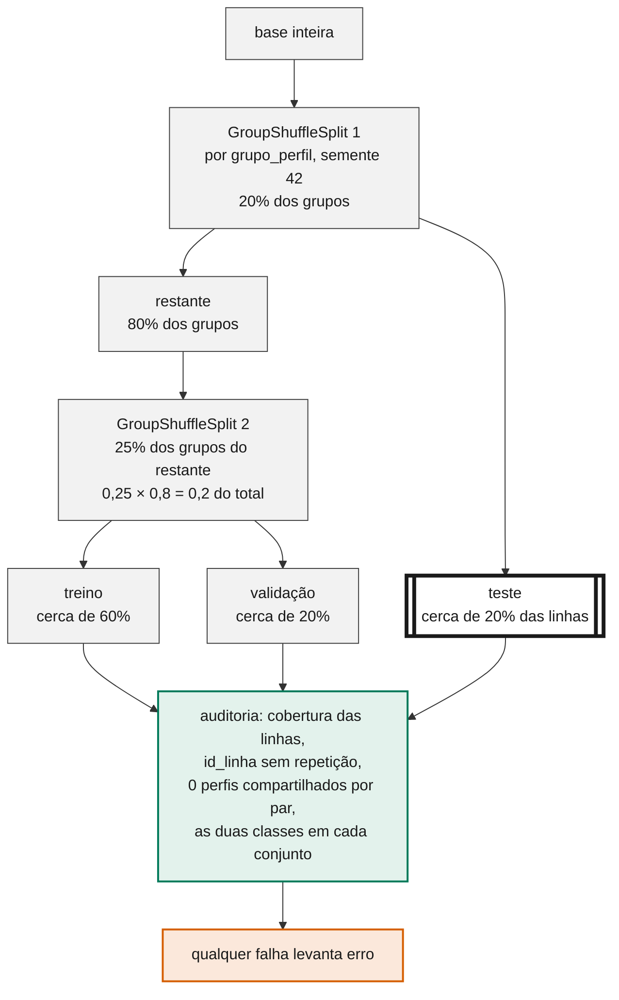

Tabela B2 (`resultados/b2_auditoria.csv`):

| Conjunto | Linhas | Proporção das linhas | Desvio vs alvo (p.p.) | Positivos | Proporção positiva | Perfis |
|---|---:|---:|---:|---:|---:|---:|
| Treino | 961 | 60,10% | 0,10 | 139 | 14,46% | 815 |
| Validação | 318 | 19,89% | -0,11 | 33 | 10,38% | 272 |
| Teste | 320 | 20,01% | 0,01 | 45 | 14,06% | 272 |

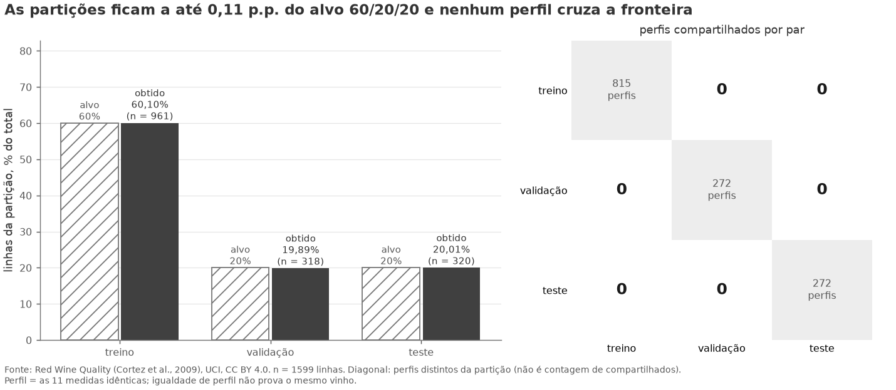
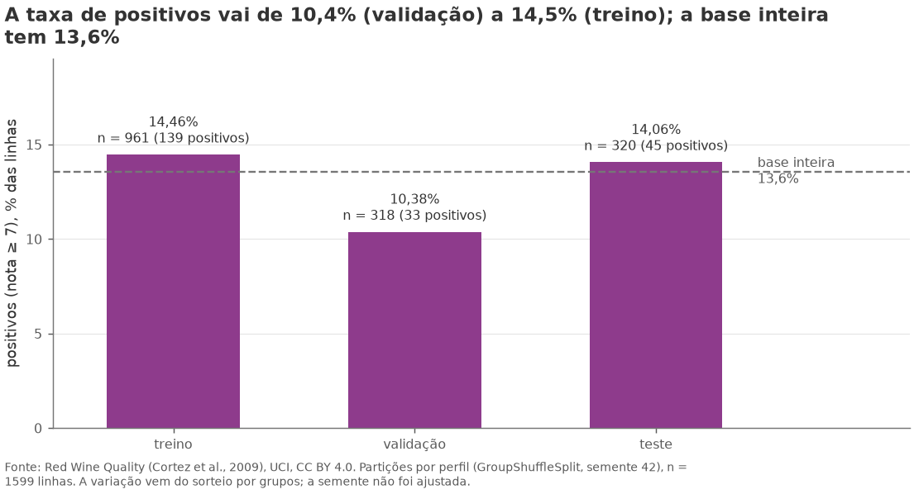

Os pares estão em `resultados/b2_pares.csv` (0 `id_linha` e 0 perfis compartilhados em todos); `auditar_particoes` levanta erro se qualquer verificação falhar. A validação tem só 33 positivos, o que pesa nas escolhas da Parte D. **Limites:** `id_linha` disjunto não prova ausência de características repetidas (por isso o controle é o `grupo_perfil`), e não há avaliação temporal, de produtores novos ou de outros domínios.

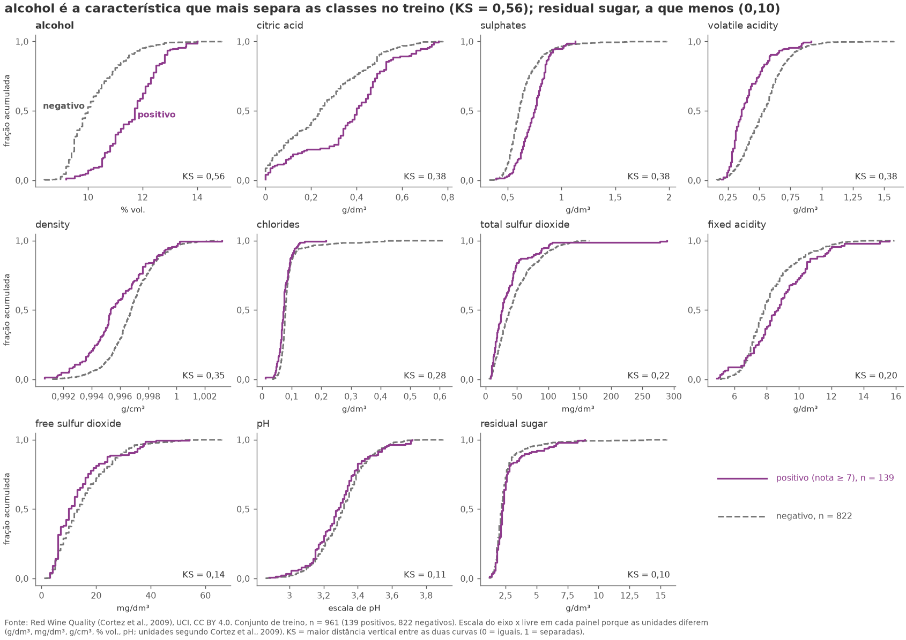

A figura acima usa só o treino; o KS por característica está em `resultados/eda_ks.csv`.

## A1 — Dataset
`MeuDataset(df, features, media=None, desvio=None)` (`lab02lib/data.py`) devolve `X` float32 `[11]` e `y` float32 escalar. No treino, média e desvio saem das próprias linhas, em float64; validação e teste recebem os do treino. **Convenção:** desvio populacional (`ddof=0`); desvio zero vira 1,0. Tamanhos: treino 961, validação 318, teste 320; lotes `[B, 11]` e `[B]` sem NaN ou infinito (conferido no notebook).

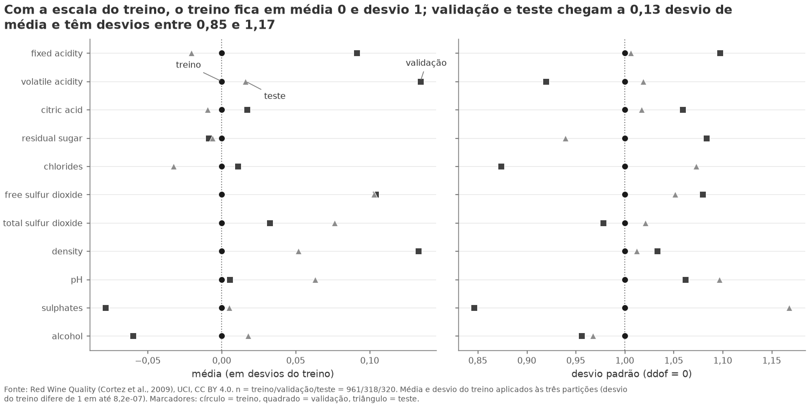

## A2 — DataLoader
| Conjunto | batch_size | shuffle | drop_last | num_workers | Justificativas |
|---|---|---|---|---|---|
| Treino | 64 | True | False | 0 | 16 atualizações por época com 961 linhas, entre o lote 1 e o 512 (ver A3). Embaralhar muda a ordem a cada época, com gerador semeado. Não descarto o último lote (sobra 1 linha) porque a rede não tem BatchNorm. |
| Validação | 512 | False | False | 0 | Sem gradientes, o lote só afeta memória; as 318 linhas cabem em um lote. Sem embaralhar, a ordem dos escores é a dos rótulos. |
| Teste | 512 | False | False | 0 | Mesmo raciocínio (320 linhas); só é percorrido na avaliação final. |

`num_workers=0`: os dados já estão em tensores. **Não medi** workers maiores que zero, então não afirmo ganho ou perda. Os parâmetros são lidos dos carregadores (`resultados/a2_loaders.csv`).

## A3 — Tempo por época
Uma época completa de `treinar_epoca` (previsão, perda, retropropagação, passo do Adam) com `time.perf_counter()`, na rede **sem BatchNorm**, modelo reconstruído do mesmo estado inicial, Adam e DataLoader novos a cada medida, uma época de aquecimento por tamanho e três repetições em rodízio; nada foi descartado. Equipamento: Apple M1, CPU, 4 threads do torch, torch 2.14.1, Python 3.11.15.

| Lote | Repetição 1 (s) | Repetição 2 (s) | Repetição 3 (s) | Mediana (s) | Passos |
|---|---|---|---|---|---|
| 1 | 0,27302 | 0,26873 | 0,26715 | 0,26873 | 961 |
| 8 | 0,04198 | 0,04141 | 0,04136 | 0,04141 | 121 |
| 64 | 0,00823 | 0,00773 | 0,00777 | 0,00777 | 16 |
| 512 | 0,00402 | 0,00407 | 0,00342 | 0,00402 | 2 |

(`resultados/a3_tempos.csv`, `a3_resumo.csv`, `a3_hardware.json`.)

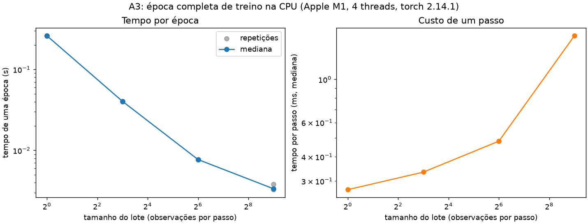

**Análise.** A mediana de uma época foi 0,2687 s com lote 1, 0,0414 s com lote 8, 0,0078 s com lote 64 e 0,0040 s com lote 512. Cada aumento de 8 vezes no lote dividiu o tempo por 6,5, 5,3 e 1,9. O ganho encolhe a cada degrau, mas **não achata** na faixa medida, então não aponto ponto de retorno decrescente. O custo de **um passo** sobe com o lote (0,280 ms, 0,342 ms, 0,485 ms, 2,011 ms), mas menos que o lote: 512 vezes mais linhas por passo custam 7,2 vezes mais tempo por passo. Por isso a época encurta: há menos passos (961, 121, 16, 2), e portanto menos atualizações de pesos por época; tempo por época menor não quer dizer o mesmo aprendizado. A repetição mais lenta de cada lote foi a 1 (lote 1), 1 (lote 8), 1 (lote 64), 2 (lote 512); o maior desvio contra a mediana foi o do lote 64 (repetição 1, 1,1× a mediana), ou seja, as repetições ficaram próximas. Os números dependem desta máquina e de torch 2.14.1.

## A4 — BatchNorm
Subconjunto de 65 linhas do treino, lote 64 (`65 % 64 = 1`, confirmado por `assert`), `criar_modelo(11, batchnorm=True)`, `drop_last=False`. Mensagem original capturada (só `ValueError` com este texto; log em `resultados/a4_log.txt`): `Expected more than 1 value per channel when training, got input size torch.Size([1, 16])`, no lote de tamanho 1.

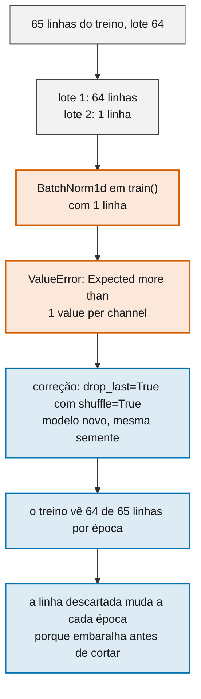

**Correção:** `drop_last=True` com `shuffle=True`, só no treino, com **modelo novo** e a mesma semente (o primeiro já tinha dado um passo). Resultado: 1 passo por época, 64 das 65 linhas vistas; as descartadas nas três épocas foram `id_linha` 1318, 688 e 567. Validação e teste não usam `drop_last=True` (toda observação precisa ser avaliada) e avaliam com `eval()`. O modelo principal não usa BatchNorm.

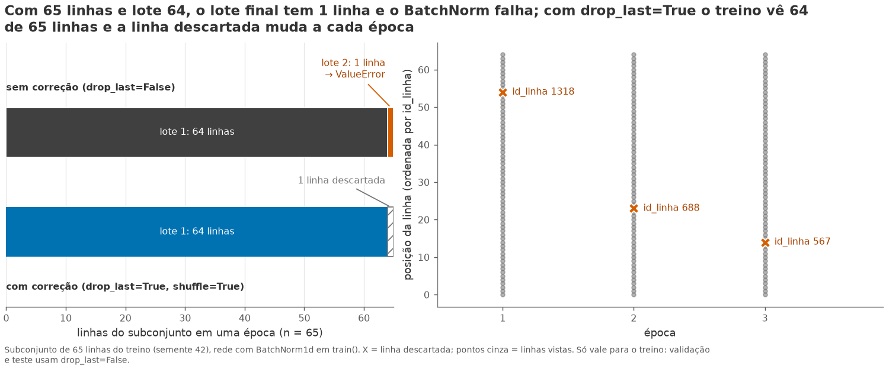

## C — Duas formas de vazamento
Formas **1** (pré-processamento aprendido com dados reservados) e **4** (duplicatas entre aprendizagem e avaliação), ambas com dados reais. Protocolo comum: rede 11→16→1, `BCEWithLogitsLoss`, Adam 1e-3, lote 64, **100 épocas fixas, sem parada antecipada**, acurácia (limiar 0,5) e AUC-ROC na avaliação interna, **5 sementes declaradas antes (0 a 4)**, nenhuma descartada; na mesma semente, incorreto e corrigido compartilham inicialização e embaralhamento. Diferença = `100 × (incorreto − corrigido)`, em p.p. na acurácia e pontos de AUC×100 na AUC-ROC; o desvio entre sementes (`ddof=1`) **não é erro-padrão**, porque as partições se sobrepõem. Valores por semente em `resultados/c_resultados.csv` (20 execuções), resumo em `c_resumo.csv` e `c_tabela.csv`.

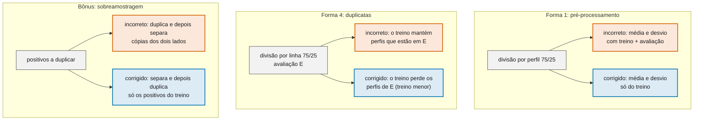

**Forma 1.** Informação protegida: as linhas da avaliação. Cruza no z-score: o incorreto usa todas as linhas de treino + validação. Partição interna 75/25 por perfil. Corrigido: estatísticas só do treino interno. **Expectativa declarada antes:** efeito perto de zero.

**Forma 4.** Informação protegida: os perfis da avaliação. O incorreto divide por linha (25%), então perfis atravessam; o corrigido usa o **mesmo conjunto de avaliação** e tira do treino todo perfil que está nele (treino menor).

Tabela C (média ± desvio entre as 5 sementes):

| forma | dados usados | métrica | incorreto (média ± desvio) | corrigido (média ± desvio) | diferença (média ± desvio) / unidade | informação indevida |
|---|---|---|---|---|---|---|
| 1: pré-processamento aprendido com dados reservados | treino + validação da B2, partição interna 75/25 por perfil | acurácia (limiar 0,5) | 0,8688 ± 0,0097 | 0,8688 ± 0,0097 | 0,000 ± 0,000 p.p. | média e desvio calculados também com as linhas de avaliação |
| 1: pré-processamento aprendido com dados reservados | treino + validação da B2, partição interna 75/25 por perfil | AUC-ROC | 0,8510 ± 0,0155 | 0,8510 ± 0,0157 | 0,004 ± 0,156 pontos de AUC×100 | média e desvio calculados também com as linhas de avaliação |
| 4: duplicatas entre aprendizagem e avaliação | treino + validação da B2, partição interna 75/25 por linha; o corrigido tira do treino os perfis da avaliação | acurácia (limiar 0,5) | 0,8794 ± 0,0137 | 0,8744 ± 0,0146 | 0,500 ± 0,280 p.p. | linhas de avaliação com o mesmo perfil de linhas do treino |
| 4: duplicatas entre aprendizagem e avaliação | treino + validação da B2, partição interna 75/25 por linha; o corrigido tira do treino os perfis da avaliação | AUC-ROC | 0,8795 ± 0,0166 | 0,8681 ± 0,0222 | 1,145 ± 0,781 pontos de AUC×100 | linhas de avaliação com o mesmo perfil de linhas do treino |

Os "dados usados" são as 1279 linhas de treino + validação da B2; o teste principal não entra.

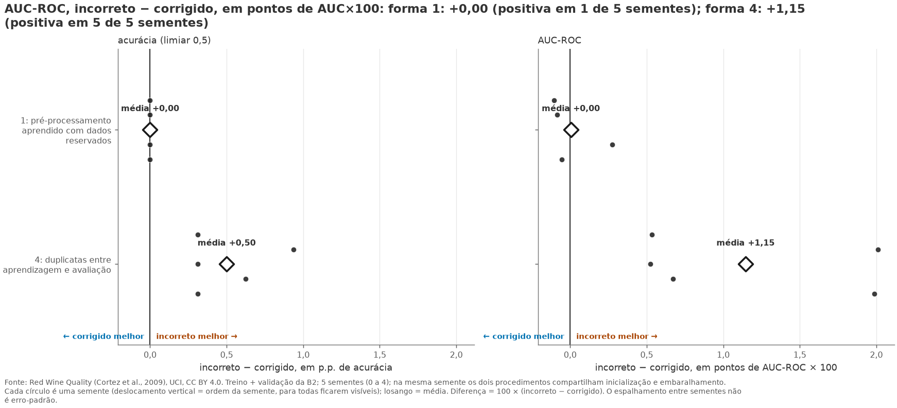
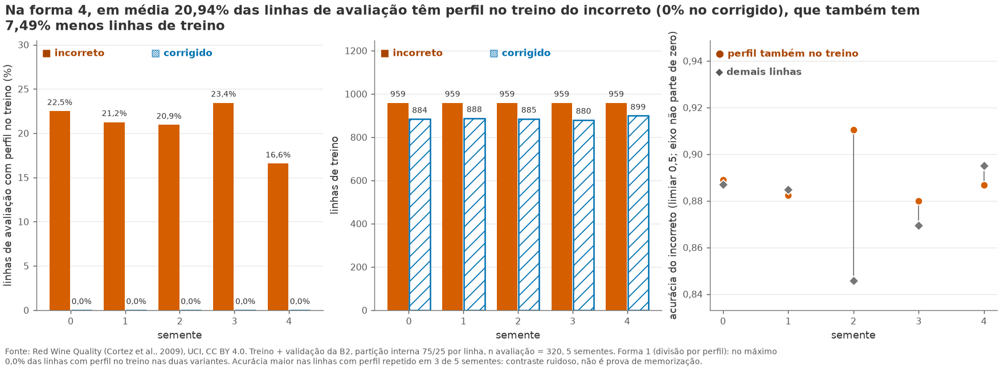

**Forma 1.** Na acurácia a diferença é 0,000 p.p. em todas as sementes (previsões em 0,5 iguais). Na AUC-ROC, 0,004 ponto (desvio 0,156; de -0,105 a 0,276), positiva em 1 de 5 sementes. É o que eu previ: efeito praticamente nulo. O vazamento **existe**, mas com 11 características e cerca de mil linhas, 25% a mais de linhas muda pouco média e desvio (explicação provável, não medida). Efeito pequeno não prova que o procedimento é seguro.

**Forma 4.** O incorreto ficou acima do corrigido nas 5 sementes: 0,500 p.p. na acurácia (desvio 0,280) e 1,145 ponto de AUC×100 (desvio 0,781; de 0,525 a 2,011). É pouco. O mecanismo está nas contagens (figura): em média 20,9% das linhas da avaliação (53 a 75 de 320) têm o perfil também no treino do incorreto; no corrigido, zero. Duas limitações: a diferença mistura o fim do vazamento com um treino menor (880 a 899 linhas contra 959), e a rede pequena, em 100 épocas, pode não aproveitar as cópias (não testado). O contraste de acurácia nas linhas repetidas (maior em 3 de 5 sementes) é ruidoso e não é prova de memorização.

**Como preservei o teste principal.** (1) A Parte C só usa `c_desenvolvimento = treino + validação`, com `assert` de que nenhum `id_linha` do teste entra. (2) As variáveis da parte C do notebook começam com `c_` (uma célula confere), exceto `resultados_c`. (3) No começo da D o notebook **apaga** as variáveis `c_`. (4) A D treina um modelo novo, semente 42. (5) Os escores do teste saem uma única vez, na D1 (um objeto conta as chamadas e recusa a segunda).

### Bônus — oitava forma: sobreamostragem antes de separar
*Esta subseção e a seção "Bônus" do notebook podem ser apagadas sem afetar mais nada.*

Duplicar os positivos **antes** de separar põe cópias dos dois lados; a duplicata é fabricada pelo pré-processamento (na forma 4 ela já está nos dados). Mesma rede, sementes e protocolo da C; cada positivo copiado uma vez (fator declarado antes). O incorreto copia e depois separa por linha (25%); o corrigido separa e copia só o treino. A prevalência da avaliação difere (24,4% contra 13,8%), então a acurácia não é comparável e leio a AUC-ROC.

AUC-ROC do incorreto 0,8828 ± 0,0104; do corrigido 0,8881 ± 0,0157; diferença -0,522 ± 1,863 pontos de AUC×100, positiva em 2 de 5 sementes (de -3,737 a 0,893). **O efeito na AUC-ROC é nulo, de sinal misto e menor que o desvio entre sementes** (`resultados/bonus_resultados.csv`, `bonus_resumo.csv`). O mecanismo aparece na contagem: em média 65,6 dos 88,4 positivos da avaliação do incorreto (74,2%) têm o par exato no treino; no corrigido, zero. A revocação (0,5) do incorreto foi 0,576 nos positivos com par e 0,623 nos demais, sem sinal de memorização. Reporto sem ajuste para aumentar o efeito.

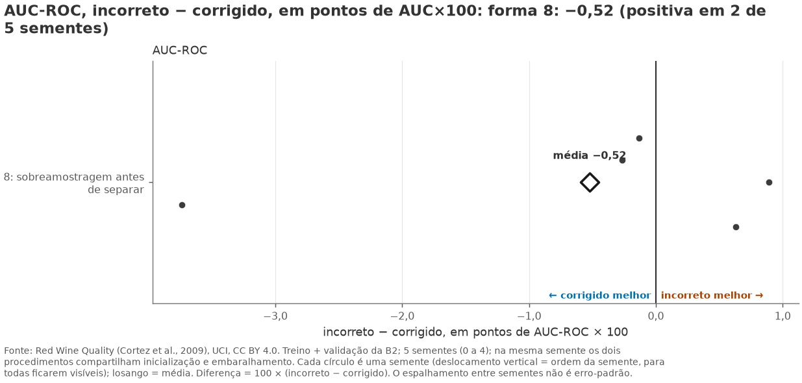
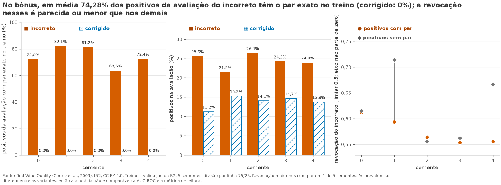

## D7 — Treinamento e parada
**Configuração.** Rede 11→16→1 (`Linear(11,16)`, ReLU, `Linear(16,1)`), `BCEWithLogitsLoss` sem ponderação, Adam `lr=1e-3`, lote 64 com embaralhamento semeado, semente 42. Parada pela **perda de validação**: máximo 100 épocas, paciência 10, melhora mínima 0,0001 (melhora = `perda_val < melhor − min_delta`). `treinar_com_parada` **não recebe o carregador de teste** (assinatura conferida no notebook).

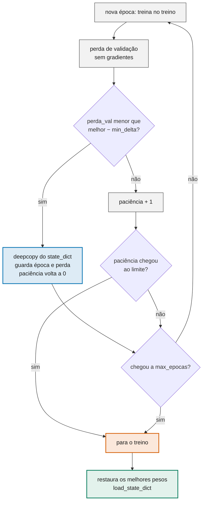

**Resultado** (`resultados/d7_historico.csv`). Melhor época **49** (perda de validação 0,2652); parada na **59**, por **paciência**. Na última época o treino continuou caindo (0,2644) e a validação voltou a subir (0,2658): ajuste ao treino além do que generaliza. **Restauração:** `copy.deepcopy(modelo.state_dict())` ao melhorar; ao parar, os pesos da época 49 voltam ao modelo, com prova no notebook (`torch.equal` em todos os tensores; perda de validação recalculada 0,26522970 igual à guardada).

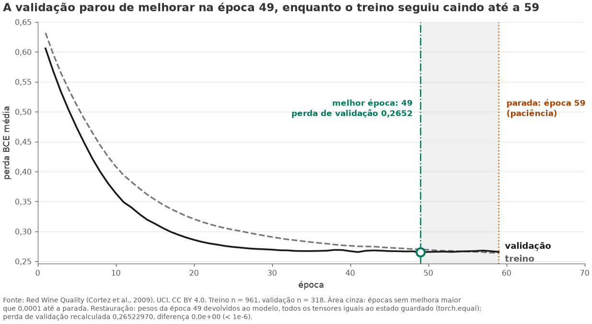

## D4 — Matriz de custos
**Ação.** Prever positivo **seleciona** a amostra para análise especial. **FP:** selecionar uma de nota abaixo de 7. **FN:** deixar de selecionar uma de nota pelo menos 7. **`C_FP = 1` e `C_FN = 5`**, em "pontos de esforço"; acertos custam zero. **São hipóteses do exercício**: a base não traz custo real. A razão 1:5 diz que perder uma amostra de alta nota pesa cinco vezes mais que gastar uma análise.

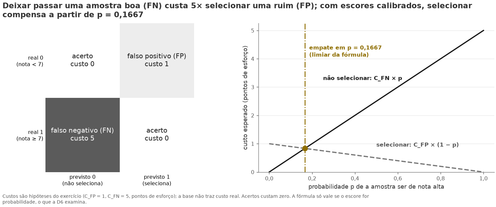

## D5 e D6 — Escolha na validação
**Candidatos e desempate.** Todos os escores únicos da validação mais um valor logo acima do máximo (`np.nextafter`); 273 candidatos; busca exata, não grade. **Desempate** (fixado antes): custo mínimo igual, o mais próximo de 0,5; se persistir, o menor. Só 1 limiar teve o custo mínimo, então o desempate não foi usado.

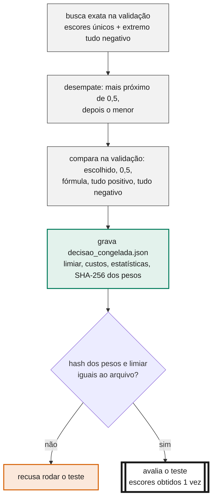

Comparação na validação (`resultados/d5_comparacao.csv`, `d5_busca_limiar.csv`):

| Regra | Limiar | FP | FN | Custo total | Custo/observação |
|---|---:|---:|---:|---:|---:|
| escolhido na busca | 0,2766 | 33 | 9 | 78 | 0,2453 |
| padrão 0,5 | 0,5000 | 12 | 25 | 137 | 0,4308 |
| fórmula C_FP/(C_FP+C_FN) | 0,1667 | 56 | 8 | 96 | 0,3019 |
| tudo positivo | não se aplica | 285 | 0 | 285 | 0,8962 |
| tudo negativo | não se aplica | 0 | 33 | 165 | 0,5189 |

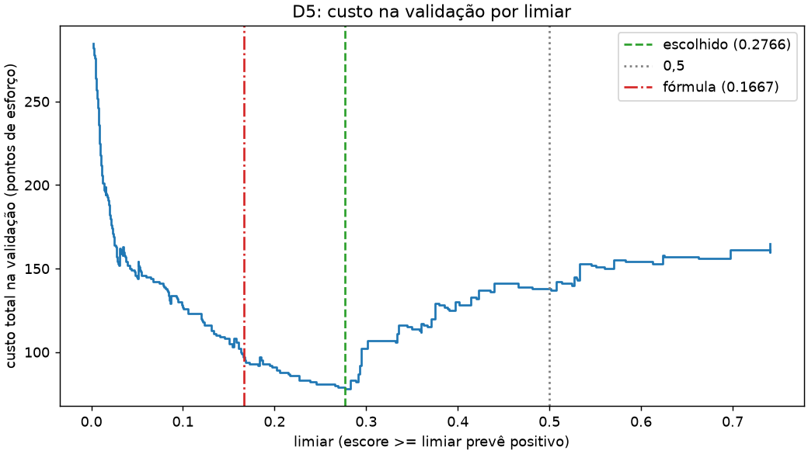

A mesma validação decidiu a parada (D7) e agora decide o limiar: são números de desenvolvimento e **otimistas**, não a estimativa final.

**Busca contra fórmula** (0,2766 contra 0,1667; com o limiar da fórmula, custo 96). O que sei de cada motivo:
- **Poucos positivos:** 33 em 318 (10,38%, contra 14,46% no treino); a curva de custo é uma escada irregular e um FN a mais muda o custo em 5 pontos.
- **Escores sem garantia de calibração:** a fórmula supõe escore igual à probabilidade. Brier na validação 0,0790 (escore constante igual à prevalência: 0,0930). O diagrama (5 bins por quantis, cerca de 63 observações cada) **apoia a discussão e não prova calibração**; o bin 4 tem a maior distância (escore médio 0,148, fração observada 0,047).
- **Busca exata, não grade:** a diferença não vem de resolução.
- **Sem peso de classe nem reamostragem** (decisão do laboratório): compatível com um corte abaixo de 0,5, mas não testei.

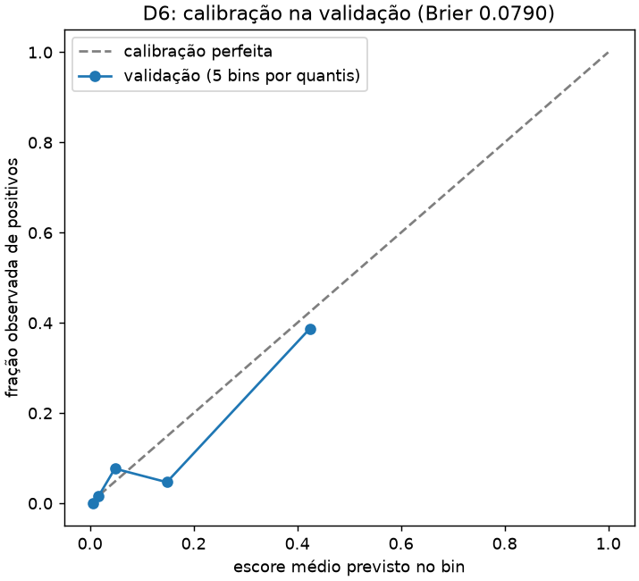

Não ajustei o modelo para as duas respostas coincidirem e não olhei o teste.

**Configuração congelada antes do teste** (`resultados/decisao_congelada.json`): limiar 0,2766, desempate, `C_FP=1`, `C_FN=5`, as 11 características, média e desvio do treino (`ddof=0`), arquitetura, melhor época (49), semente 42 e SHA-256 dos pesos restaurados `bfc098ee58b67c8d6a1ea9eb7c19f26dd75a221023422ba9e2073bdf285b58f7`. A avaliação final confere o hash antes de abrir o teste.

## D1 e D2 — Avaliação final
**Proporção positiva do teste:** 45 de 320 (14,06%). Escores obtidos **uma vez** (contador conferido). **Convenções:** matriz com linhas = real e colunas = previsto, ordem `[0, 1]`; AUCs dos escores; AUC-PR é a área trapezoidal `auc(recall, precision)`, e o **AP** (`average_precision_score`) é 0,5740, diferente da AUC-PR (0,5644); sem previsão positiva, precisão = 0 (`zero_division=0`). **Trivial:** classe majoritária do treino (0); AUC-ROC e AUC-PR "não reportada", porque um preditor constante não tem ranking. Custo/observação = `(C_FP×FP + C_FN×FN)/n`, em pontos hipotéticos.

Tabela final (`resultados/d_tabela_final.csv`):

| Regra | Limiar | Acurácia | Precisão | Revocação | F1 | AUC-ROC | AUC-PR | Custo/observação |
|---|---|---|---|---|---|---|---|---|
| Trivial do treino (sempre classe 0) | não se aplica | 0,8594 | 0,0000 | 0,0000 | 0,0000 | não reportada | não reportada | 0,7031 |
| Rede: padrão | 0,5 | 0,8781 | 0,6667 | 0,2667 | 0,3810 | 0,8907 | 0,5644 | 0,5344 |
| Rede: escolhido na validação | 0,2766 | 0,8562 | 0,4912 | 0,6222 | 0,5490 | 0,8907 | 0,5644 | 0,3563 |

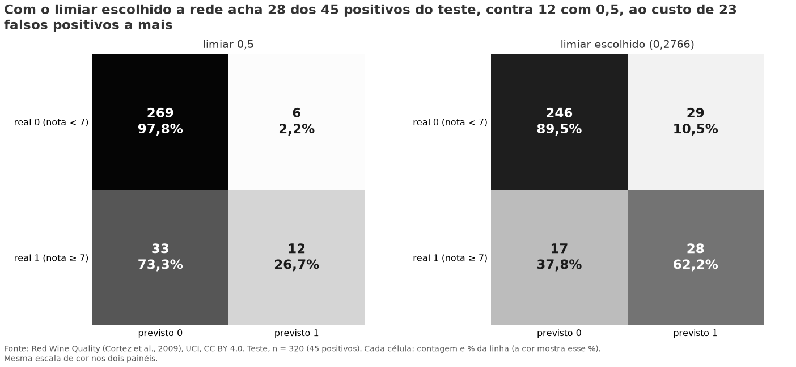
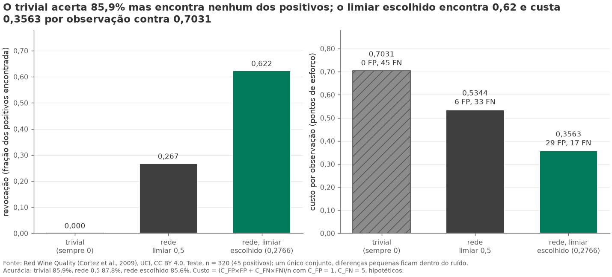

**Trivial contra rede.** O trivial acerta 85,94% e a rede com 0,5, 87,81% (só 1,88 p.p. a mais); com o limiar escolhido a acurácia é 85,62%, **abaixo** do trivial. Mas a revocação do trivial é 0,00: ele não encontra nenhuma amostra de nota alta. A rede encontra 0,267 com 0,5 e 0,622 com o limiar escolhido; o custo cai de 0,7031 (trivial) para 0,5344 e 0,3563. O limiar menor troca falsos negativos por falsos positivos (33 FN e 6 FP contra 17 FN e 29 FP). Matrizes completas em `resultados/d_matrizes.csv`.

## D3 — Curvas
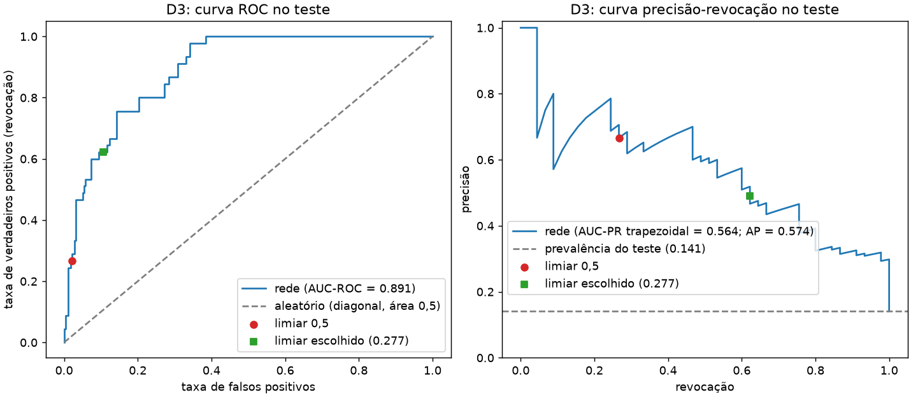

ROC com a **diagonal** aleatória (área 0,5; AUC-ROC 0,891) e PR com a **prevalência do teste** (0,141; AUC-PR trapezoidal 0,564, AP 0,574, acima da prevalência). Os dois limiares estão marcados; as áreas são iguais porque o limiar muda as classes e não o ordenamento dos escores.

## D8 — Recomendação
O modelo apoia uma triagem: marcar amostras de vinho tinto como candidatas a uma análise especial de nota alta, com o limiar 0,2766 fixado na validação antes de abrir o teste. No teste (320 linhas, 45 positivas, 14,06%), essa regra encontrou 28 das 45 positivas (revocação 0,622), com precisão 0,491 e F1 0,549, e custou 0,3563 pontos de esforço (hipotéticos) por observação, contra 0,5344 do limiar 0,5 (revocação 0,267) e 0,7031 do classificador trivial, que acerta 85,94% e não encontra nenhuma positiva. O erro que merece atenção é o falso negativo, que pesa 5 vezes mais nos custos supostos: ficaram 17 positivas sem seleção, ao lado de 29 falsos positivos. As limitações continuam abertas. Uma base só, sem teste temporal nem de produtores novos. A mesma validação serviu para parar o treino e escolher o limiar. Há poucas positivas (33 na validação e 45 no teste), e eu não medi a incerteza da diferença entre as regras. Os custos são hipóteses; com outros custos o limiar muda. Nada disso vale para produtores, regiões ou períodos que a base não permite avaliar.

## Gráficos
Todos saem de `lab02lib/graficos.py` (função `publicar`: grava o PNG em `resultados/` e mostra a mesma imagem no notebook). O título é a conclusão, gerada dos dados; cada figura traz fonte e n no rodapé.

| Arquivo | O que mostra |
|---|---|
| `b2_taxa_positiva.png` | taxa de positivos por partição contra a base inteira |
| `b2_particoes.png` | linhas por partição contra 60/20/20 e perfis compartilhados por par |
| `eda_ecdf_treino.png` | ECDF por classe das 11 características (só treino), com KS |
| `a1_normalizacao.png` | média e desvio de cada característica por conjunto, com a escala do treino |
| `a3_tempo_x_lote.png` | tempo por época e custo por passo contra o lote (log-log) |
| `a4_batchnorm.png` | lotes com e sem `drop_last` e a linha descartada por época |
| `c_diferencas.png` | diferenças pareadas por semente, formas 1 e 4 |
| `c_mecanismo_forma4.png` | perfis repetidos, tamanho do treino e acurácia nessas linhas |
| `bonus_diferencas.png`, `bonus_mecanismo.png` | o mesmo para a sobreamostragem antes de separar |
| `d7_curvas_perda.png` | perdas, melhor época, parada e prova de restauração |
| `d4_matriz_custos.png` | matriz de custos e limiar da fórmula |
| `d5_curva_custo.png` | custo por limiar na validação, com escolhido, 0,5 e fórmula |
| `d6_calibracao.png` | calibração na validação, n por bin |
| `d2_matrizes.png`, `d2_regras.png` | matrizes de confusão e revocação/custo das três regras |
| `d_curvas_roc_pr.png` | ROC e PR no teste, com os dois limiares |

**Regras aplicadas:** título = conclusão; eixos com unidade; barras a partir de zero; sem 3D, pizza ou medidor; sem bordas superior e direita; rótulos diretos em vez de legenda; nada codificado só por cor (hachura, traço, marcador ou rótulo); cinza para o que não é a mensagem; a mesma cor para a mesma entidade em todas as figuras (vermelho = incorreto, azul = corrigido, roxo = classe positiva, verde = regra escolhida, ocre = limiar da fórmula, cinzas = referências, trivial e rede com 0,5).

**Auditoria da paleta** (calculada por `auditar_paleta`; `resultados/paleta_auditoria.csv` e `paleta_pares.csv`). Contraste pela fórmula WCAG contra o branco (gráfico ≥ 3:1, texto ≥ 4,5:1); deuteranopia por Machado et al. (2009), severidade 1,0; ΔE é CIE 1976 entre as cores simuladas; L* é a luminosidade (leitura em cinza). 16 de 16 cores passam. Não usei as cores do Okabe-Ito que falham em 3:1 sobre branco (#56B4E9, #E69F00 e #F0E442: 2,31, 2,25 e 1,32); o vermelho #D55E00 passa a 3,87 e, para texto, uso a variante #A84300.

| Cor | Hex | Uso | Contraste vs branco | Mínimo | Passa | Deuteranopia | L* |
|---|---|---|---:|---:|---|---|---:|
| incorreto | `#D55E00` | gráfico | 3,87 | 3,0 | sim | `#9E8C00` | 54,2 |
| corrigido | `#0072B2` | gráfico | 5,19 | 3,0 | sim | `#3B67B1` | 46,0 |
| positivo | `#8E3B8C` | gráfico | 6,66 | 3,0 | sim | `#4F608A` | 39,2 |
| escolhido | `#007A5A` | gráfico | 5,34 | 3,0 | sim | `#6A675C` | 45,2 |
| formula | `#8F6E00` | gráfico | 4,77 | 3,0 | sim | `#85760B` | 48,2 |
| modelo | `#1A1A1A` | gráfico | 17,40 | 3,0 | sim | `#1A1A1A` | 9,3 |
| regra_05 | `#404040` | gráfico | 10,37 | 3,0 | sim | `#404040` | 27,1 |
| trivial | `#8C8C8C` | gráfico | 3,36 | 3,0 | sim | `#8C8C8C` | 58,3 |
| referencia | `#767676` | gráfico | 4,54 | 3,0 | sim | `#767676` | 49,6 |
| texto | `#333333` | texto | 12,63 | 4,5 | sim | `#333333` | 21,2 |
| texto_secundario | `#595959` | texto | 7,00 | 4,5 | sim | `#595959` | 37,8 |
| texto_incorreto | `#A84300` | texto | 6,06 | 4,5 | sim | `#796B00` | 41,8 |
| texto_positivo | `#8E3B8C` | texto | 6,66 | 4,5 | sim | `#4F608A` | 39,2 |
| texto_corrigido | `#0072B2` | texto | 5,19 | 4,5 | sim | `#3B67B1` | 46,0 |
| texto_escolhido | `#007A5A` | texto | 5,34 | 4,5 | sim | `#6A675C` | 45,2 |
| texto_formula | `#8F6E00` | texto | 4,77 | 4,5 | sim | `#85760B` | 48,2 |

| Par | ΔE em deuteranopia | ΔL em cinza | Só a cor basta | Reforço não cromático |
|---|---:|---:|---|---|
| incorreto × corrigido | 108,4 | 8,2 | não | preenchimento cheio × hachurado e rótulo direto |
| positivo × referencia | 26,9 | 10,4 | sim | traço contínuo × tracejado e rótulo direto |
| trivial × regra_05 | 31,2 | 31,2 | sim | hachura no trivial e rótulo no eixo |
| regra_05 × escolhido | 17,8 | 18,1 | não | quadrado × círculo, traço e rótulo direto |
| trivial × escolhido | 16,1 | 13,1 | não | hachura no trivial e rótulo no eixo |
| escolhido × formula | 46,9 | 3,1 | não | traço-ponto × tracejado, marcador e rótulo direto |
| regra_05 × formula | 57,7 | 21,2 | sim | pontilhado × tracejado, marcador e rótulo direto |
| modelo × referencia | 40,4 | 40,4 | sim | contínuo × tracejado e rótulo direto |
| modelo × escolhido | 34,9 | 35,9 | sim | curva × ponto, rótulo direto |

Onde "só a cor basta" é "não", a figura reforça com hachura, traço, marcador ou rótulo direto (última coluna). Por exemplo, incorreto × corrigido tem ΔE alto em deuteranopia, mas ΔL em cinza baixo; por isso as barras diferem por preenchimento cheio e hachurado.

## Decisões (ambiguidades resolvidas)
1. O ambiente virtual fica em `.venv` na raiz (ignorado pelo git). O `nbconvert` foi chamado com o `bin` do ambiente no `PATH`.
2. A3: cada repetição usa um gerador de embaralhamento com semente `42 + repetição`, igual para todos os tamanhos da rodada; o aquecimento é uma época por tamanho, numa cópia descartável.
3. Resultados extras além da lista mínima: `a1_estatisticas.csv`, `a2_loaders.csv`, `a3_resumo.csv`, `a3_hardware.json`, `b2_pares.csv`, `c_resumo.csv`, `c_tabela.csv`, `c_mecanismo_forma4.csv`, `d5_comparacao.csv`, `d6_calibracao.csv`, `eda_ks.csv`, `paleta_auditoria.csv`, `paleta_pares.csv` e as figuras.
4. `resultados/c_resultados.csv` tem uma linha por execução (forma × variante × semente) com as duas métricas em colunas.
5. "Todas as variáveis da C começam com `c_`": vale para variáveis do notebook e objetos expostos; locais das funções da biblioteca não levam o prefixo.
6. `treinar_com_parada` tem dois parâmetros opcionais a mais (`dispositivo` e `lr`); não há parâmetro de teste.
7. No MLflow, `eval/*` registra a regra congelada (limiar escolhido) e `eval_0p5/*`, o limiar 0,5.
8. A B1 está só no README, como o enunciado pede. Não adicionei testes `pytest`: as checagens são `assert` visíveis no notebook.
9. O bônus roda antes da execução final, para o notebook salvo, `resultados/` e este README virem de uma única execução.
10. Não medi `num_workers` maior que zero.
11. Os gráficos moram todos em `lab02lib/graficos.py`; as antigas funções de figura de `timing.py`, `train.py`, `decision.py` e `evaluate.py` foram removidas (sem cópia duplicada). Nenhum número mudou: só os tempos da A3 variam entre execuções.

## Referências e limites
- Cortez, P., Cerdeira, A., Almeida, F., Matos, T., Reis, J. (2009). *Wine Quality* [conjunto de dados]. UCI Machine Learning Repository. https://doi.org/10.24432/C56S3T (CC BY 4.0).
- Documentação do PyTorch (Dataset/DataLoader, `BCEWithLogitsLoss`) e do scikit-learn (`GroupShuffleSplit`, métricas, escolha de limiar, armadilhas de vazamento), indicadas no enunciado. Machado, G. M., Oliveira, M. M., Fernandes, L. A. F. (2009), simulação de deficiência de cor; paleta Okabe-Ito.
- **Limites.** Uma base, sem datas, produtores ou regiões. Perfis idênticos mantidos juntos, sem prova de que sejam o mesmo vinho. Custos hipotéticos. Validação reutilizada para parada e limiar. Poucos positivos (validação e teste). As diferenças da Parte C e do bônus são pequenas e medidas com 5 sementes sobrepostas. Os tempos dependem desta máquina e das versões listadas; os demais valores foram idênticos em execuções seguidas.
