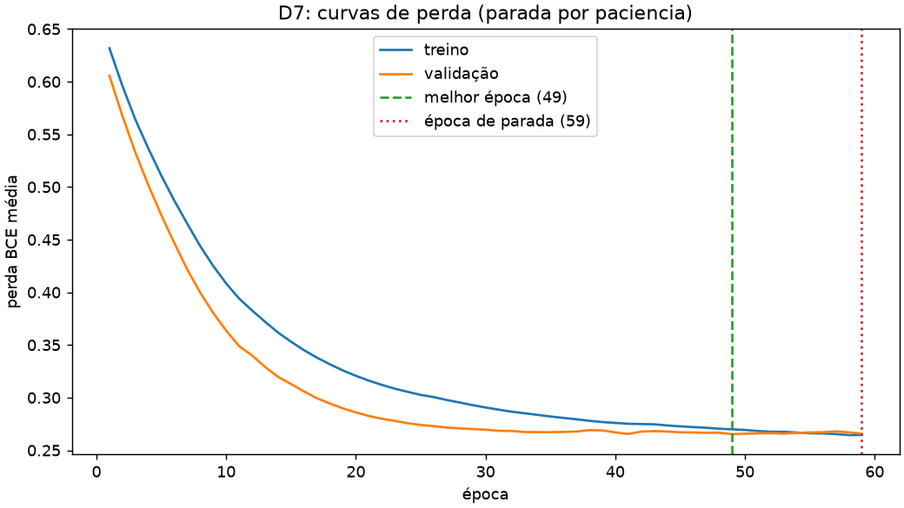
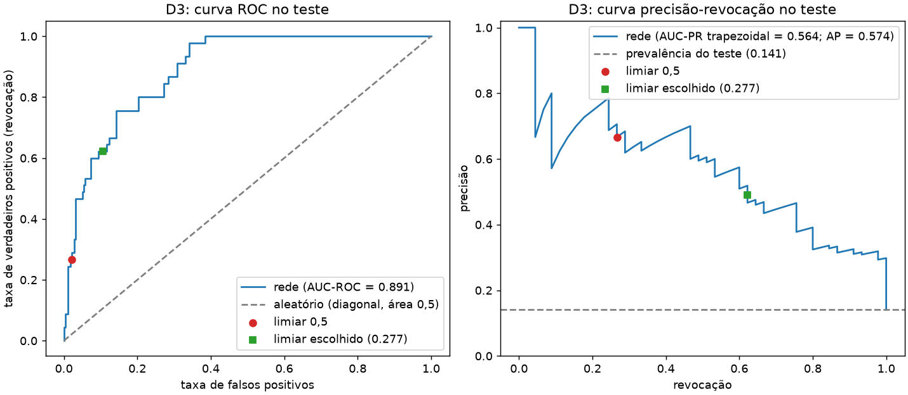

# Lab 2 — Relatório individual

Nome: João Rietra  
Turma: BD-P4-2026.2  
Link do repositório: [preencher]

Este relatório responde ao enunciado do Lab 2 (`ENUNCIADO.pdf`). Todos os números abaixo vêm de arquivos de `resultados/`, gerados pela execução do `lab02.ipynb`. Quando um resultado foi pequeno ou desfavorável, eu escrevo isso do jeito que saiu.

## Reprodução
**Ambiente.** Python 3.11.15 (Homebrew). Bibliotecas: numpy 2.4.6, pandas 3.0.6, scikit-learn 1.9.1, matplotlib 3.11.2, torch 2.14.1, mlflow 3.17.1, jupyterlab 4.6.4, ipykernel 7.4.0, nbconvert 7.17.2. Sistema: macOS 26.6.2 (Darwin 25.6.0). Equipamento: Apple M1, 8 núcleos lógicos, 4 threads do torch, só CPU (`'cpu'`). Semente global: **42** (`apoio.fixar_semente`). Todas as dependências do `requirements.txt` instalaram com as faixas originais; acrescentei só `mlflow>=3,<4`.

**Sequência de comandos** (a partir da pasta que contém `lab-02/`; o ambiente virtual fica fora de `lab-02/`):
```bash
python3.11 -m venv .venv
.venv/bin/python -m pip install -r lab-02/requirements.txt
.venv/bin/python -m ipykernel install --sys-prefix --name lab02
cd lab-02
PATH="../.venv/bin:$PATH" ../.venv/bin/python -m jupyter nbconvert --to notebook --execute --inplace lab02.ipynb \
    --ExecutePreprocessor.timeout=1800 --ExecutePreprocessor.kernel_name=lab02
```
O `PATH` com o `bin` do ambiente é necessário porque `python -m jupyter nbconvert` chama o executável `jupyter-nbconvert` que estiver no `PATH`, e o do sistema usaria outro Python. A execução completa levou 39 segundos nesta máquina na última execução. O aviso "Kernel is running over TCP without encryption" vem do próprio Jupyter, não do notebook.

**`apoio.py` não foi modificado** (SHA-256 `f6af5d69d886d8a9f471001303d246d7bda75645f7ba244fc40482246c6e6a78`, igual ao do pacote). Todo o código novo está no pacote `lab02lib/`.

**Mapa do código** (onde está cada implementação avaliada):

| Item | Implementação | Arquivo |
|---|---|---|
| B2 | `particionar_sem_vazar`, `auditar_particoes` | [lab02lib/split.py](lab02lib/split.py) |
| A1, A2 | `MeuDataset`, `criar_datasets`, `criar_loaders`, verificações | [lab02lib/data.py](lab02lib/data.py) |
| A3 | `medir_tempos`, `resumir_tempos`, `grafico_tempos` | [lab02lib/timing.py](lab02lib/timing.py) |
| A4 | `demonstrar_batchnorm` | [lab02lib/batchnorm.py](lab02lib/batchnorm.py) |
| C (formas 1 e 4) | `executar_forma1`, `executar_forma4`, `resumir_c` | [lab02lib/leakage.py](lab02lib/leakage.py) |
| D7 | `treinar_com_parada`, `verificar_restauracao` | [lab02lib/train.py](lab02lib/train.py) |
| D4, D5, D6 | custos, `buscar_limiar`, fórmula, calibração, `congelar` | [lab02lib/decision.py](lab02lib/decision.py) |
| D1, D2, D3 | `avaliar_teste`, `EscoresUmaVez`, curvas ROC e PR | [lab02lib/evaluate.py](lab02lib/evaluate.py) |
| Bônus | `executar_bonus` | [lab02lib/bonus.py](lab02lib/bonus.py) |
| MLflow (opcional) | registro em `mlflow.db` | [lab02lib/tracking.py](lab02lib/tracking.py) |

O registro no MLflow é opcional e fica em um único `mlflow.db` (ignorado pelo git). `LAB02_TRACKING=0` desliga tudo. O notebook também exporta as tabelas e figuras para `resultados/`, que são a evidência da entrega.

## Base e definição do alvo
**Fonte:** Red Wine Quality (Cortez et al., 2009), cópia da UCI (CC BY 4.0), detalhes em `dados/FONTE-E-LICENCA.md`. O CSV original tem 1599 linhas, 11 medidas físico-químicas numéricas e a nota sensorial `quality`; o SHA-256 é conferido em `carregar_base`. **Alvo:** `quality >= 7` (classe 1). Há 217 positivos, 13,57% das linhas. **Unidade de observação:** uma amostra de vinho tinto. **Características:** só as 11 de `apoio.FEATURES`; `quality`, `alvo`, `id_linha` e `grupo_perfil` ficam fora (há `assert` no notebook e no `MeuDataset`).

**Limitações.** A fronteira 7 é convenção do laboratório. Há linhas com as mesmas 11 medidas, por isso uso `grupo_perfil` (hash das 11 medidas) para manter perfis idênticos juntos. Perfis iguais não provam que o vinho físico é o mesmo. A base não traz data, produtor nem região, então não dá para avaliar tempo futuro, produtores novos ou outros domínios.

## B1 — Cinco cenários
**1. Avaliações de produtos.** Pressuponho que o modelo vai classificar avaliações de **usuários novos**. Então separo por usuário (`GroupShuffleSplit` com o id do autor). Num sorteio aleatório, as avaliações do mesmo usuário caem nos dois lados, e o estilo dele atravessa a fronteira: vocabulário, hábito de dar nota máxima, tamanho do texto. O modelo aprenderia o autor e não o produto. Se o uso fosse só para usuários já conhecidos, o sorteio aleatório seria defensável, e eu diria isso. Hipótese: não sei se há data nem produto; com produto, eu olharia também esse eixo.

**2. Turbinas.** O uso é prever falha nas próximas 24 horas, então o teste tem de ser o futuro: separo por ordem do tempo dentro de cada turbina (treino no começo, validação depois, teste no fim), com uma folga de 24 h entre os blocos. Num sorteio, o minuto t vai para o treino e o minuto t+1 para o teste, e janelas de 24 h que se sobrepõem repetem a mesma falha em muitas linhas. Preciso decidir o que "futuro" quer dizer: mesmas turbinas em tempo novo (bloco de tempo), turbinas novas (grupo por turbina) ou os dois. Hipótese: sem essa decisão, assumo tempo novo nas mesmas turbinas e declaro o limite.

**3. Spam.** Com 200 mil e-mails e 3% de spam, a divisão aleatória **estratificada** é defensável: mantém os 3% em cada conjunto e há muitos exemplos. A ressalva é que e-mails de uma mesma campanha, ou de uma mesma conversa, são quase cópias, e o sorteio os espalha pelos conjuntos. Se houver remetente, campanha ou thread, agrupo por eles. Se o spam muda com o tempo, o certo é separar por data. Hipótese: sem esses metadados, uso estratificado aleatório e registro o limite. Com 3% de spam, a acurácia sozinha engana.

**4. Radiografias de tórax.** São 8000 imagens de 900 pacientes, cerca de nove por paciente. Separo **por paciente**, porque o uso futuro é laudar pacientes novos. O mesmo paciente tem exames repetidos, a mesma anatomia e, muitas vezes, o mesmo aparelho e o mesmo protocolo. Num sorteio por imagem, o modelo pode reconhecer o paciente (posição, dispositivo implantado, cicatriz) em vez do achado. No acompanhamento clínico isso é comum: o exame de retorno de um paciente se parece muito com o anterior. Se for preciso equilibrar o achado, estratifico por achado **dentro** da divisão por paciente. Hipótese: não sei de qual hospital vem cada imagem; se houver mais de um, o serviço ou o aparelho viram outro eixo de vazamento.

**5. Transações de cartão.** Aqui há dois eixos, tempo e identidade do cliente. Fraude muda com o tempo, então treino no passado e testo no futuro (por exemplo, treino nos primeiros anos, validação logo depois e teste no período mais recente). Quanto ao cliente, depende do objetivo. Se o sistema vai atender clientes que já aparecem no treino, o mesmo cliente nos dois lados é aceitável e até realista. Se vai atender clientes novos, o teste precisa ter clientes que não estão no treino (grupo por cliente). Pode ser preciso os dois ao mesmo tempo: período futuro e clientes novos. Num sorteio aleatório, transações do mesmo cliente e do mesmo cartão (rajadas de fraude) atravessam os conjuntos. Hipótese: sem o objetivo declarado, assumo clientes conhecidos e tempo futuro.

## B2 — Auditoria da separação
**Pergunta de uso:** selecionar amostras de vinho tinto de nota alta usando só as 11 medidas físico-químicas.

**Estratégia.** `GroupShuffleSplit` por `grupo_perfil`, duas vezes, com semente 42. A primeira reserva 20% dos grupos para o teste. A segunda separa 25% dos grupos restantes (0,25 de 0,8 = 0,2 do total) para a validação. As proporções valem para grupos, então as de linhas só se aproximam de 60/20/20. A semente 42 foi declarada antes de qualquer modelo; **não procurei semente por métrica** e a conferência das classes foi só validação do desenho.

Tabela B2 (`resultados/b2_auditoria.csv`):

| Conjunto | Linhas | Proporção das linhas | Desvio vs alvo (p.p.) | Positivos | Proporção positiva | Perfis |
|---|---:|---:|---:|---:|---:|---:|
| Treino | 961 | 60,10% | 0,10 | 139 | 14,46% | 815 |
| Validação | 318 | 19,89% | -0,11 | 33 | 10,38% | 272 |
| Teste | 320 | 20,01% | 0,01 | 45 | 14,06% | 272 |

Verificações (`resultados/b2_pares.csv`; a função `auditar_particoes` levanta erro se alguma falhar): as 1599 linhas estão cobertas, sem repetição de `id_linha`; as duas classes aparecem nos três conjuntos; os perfis somam 1359, igual aos 1359 perfis distintos do arquivo (contagem do `DICIONARIO.md`).

| Par | `id_linha` compartilhados | Perfis compartilhados |
|---|---:|---:|
| treino-validacao | 0 | 0 |
| treino-teste | 0 | 0 |
| validacao-teste | 0 | 0 |

O maior desvio de proporção de linhas é 0,11 ponto percentual. A proporção de positivos varia entre os conjuntos (14,46%, 10,38% e 14,06%) porque o sorteio é por grupos; não mexi na semente para igualar. A validação tem só 33 positivos, o que pesa nas escolhas da Parte D.

**Limites.** Ausência de `id_linha` em comum não prova ausência de repetição de características: por isso o controle principal é o `grupo_perfil`. Dois perfis iguais também não provam o mesmo vinho físico. Não há avaliação temporal, de produtores novos ou de outros domínios, porque a base não traz esses metadados.

## A1 — Dataset
`MeuDataset(df, features, media=None, desvio=None)` (`lab02lib/data.py`) devolve `X` float32 `[11]` e `y` float32 escalar; `__init__`, `__len__` e `__getitem__` têm docstring. No treino, média e desvio saem das próprias linhas, em float64, e ficam guardados em float32. Validação e teste recebem os do treino. **Convenção:** desvio populacional (`ddof=0`); desvio zero vira 1,0.

Tamanhos: treino 961, validação 318, teste 320. Em lote, as formas são `[B, 11]` e `[B]`, e nenhum lote dos três carregadores tem NaN ou infinito (conferido no notebook). Validação e teste usam exatamente as estatísticas do treino (arrays iguais, conferido com `np.array_equal`). Maior média absoluta de uma coluna (`resultados/a1_estatisticas.csv`): treino 1,3e-06, validação 0,134, teste 0,103. Média diferente de zero na validação e no teste é o esperado, porque a escala é a do treino.

## A2 — DataLoader
| Conjunto | batch_size | shuffle | drop_last | num_workers | Justificativas |
|---|---|---|---|---|---|
| Treino | 64 | True | False | 0 | Lote 64 dá 16 atualizações por época com 961 linhas, um meio-termo entre o lote 1 e o 512 (ver A3). Embaralhar muda a ordem dentro do treino a cada época, com gerador semeado, e não toca na separação entre partições. Não descarto o último lote (sobra 1 linha) porque esta rede não tem BatchNorm. |
| Validação | 512 | False | False | 0 | Sem gradientes, o lote só afeta memória, e a validação inteira (318 linhas) cabe num lote. Sem embaralhar, a ordem dos escores é a dos rótulos. Nenhuma observação é descartada. |
| Teste | 512 | False | False | 0 | Mesmo raciocínio da validação (320 linhas). O teste só é percorrido na avaliação final. |

`num_workers=0` nos três: os dados já estão em tensores na memória, e processos auxiliares custam para abrir. **Não medi** workers maiores que zero, então não afirmo que ajudam ou atrapalham. Os parâmetros da tabela são lidos dos carregadores criados (`resultados/a2_loaders.csv`).

## A3 — Tempo por época
Medi uma época completa de `treinar_epoca` (previsão, perda, retropropagação e passo do Adam) com `time.perf_counter()`, na rede **sem BatchNorm**. Cada medição reconstrói o modelo do mesmo estado inicial, com Adam novo e DataLoader novo (o `loader_treino` da Parte D não é tocado). Fiz uma época de aquecimento por tamanho, fora da medição, e as três repetições rodam em rodízio entre os tamanhos (1, 8, 64, 512, depois de novo), para a oscilação da máquina não cair sempre no mesmo lote. Nada foi descartado. Equipamento: Apple M1, CPU, 4 threads do torch, torch 2.14.1, Python 3.11.15.

Tabela A3 (`resultados/a3_tempos.csv` e `a3_resumo.csv`; figura `resultados/a3_tempo_x_lote.png`):

| Lote | Repetição 1 (s) | Repetição 2 (s) | Repetição 3 (s) | Mediana (s) | Passos |
|---|---|---|---|---|---|
| 1 | 0,26041 | 0,25853 | 0,26106 | 0,26041 | 961 |
| 8 | 0,04052 | 0,04036 | 0,04002 | 0,04036 | 121 |
| 64 | 0,00770 | 0,00773 | 0,00765 | 0,00770 | 16 |
| 512 | 0,00382 | 0,00335 | 0,00327 | 0,00335 | 2 |

**Análise.** A mediana de uma época foi 0,2604 s com lote 1, 0,0404 s com lote 8, 0,0077 s com lote 64 e 0,0034 s com lote 512. Cada aumento de 8 vezes no lote dividiu o tempo por 6,5, 5,2 e 2,3. O ganho encolhe a cada degrau, mas **não achatou** na faixa medida: o último degrau ainda mais que dobrou a velocidade, então não aponto um ponto de retorno decrescente. O custo de **um passo** sobe com o lote: 0,271 ms, 0,334 ms, 0,481 ms e 1,676 ms. O custo por passo cresce bem menos que o lote (512 vezes mais linhas por passo, cerca de 6,2 vezes mais tempo por passo), por isso a época fica mais curta: há menos passos (961, 121, 16 e 2). Lotes diferentes também significam **quantidades diferentes de atualizações de pesos por época**: 961 com lote 1 e 2 com lote 512. Tempo por época menor não quer dizer o mesmo aprendizado por época. Ressalvas: a medição do lote 512 dura poucos milissegundos, e a primeira repetição dele (0,00382 s) ficou acima das outras duas (0,00335 s e 0,00327 s), então esse valor é o mais sensível a ruído. Os números dependem desta máquina e de torch 2.14.1.

## A4 — BatchNorm
**Condição.** Subconjunto de 65 linhas só do treino (sorteio com semente), lote 64: `65 % 64 = 1`, confirmado por `assert`. Rede `criar_modelo(11, batchnorm=True)` em `train()` e `drop_last=False`. O último lote tem **1 observação**, e `BatchNorm1d` não calcula variância com uma amostra.

**Mensagem original capturada** (só `ValueError` com este texto; o resto continua subindo; log em `resultados/a4_log.txt`):

```
Expected more than 1 value per channel when training, got input size torch.Size([1, 16])
```
Lote que falhou: tamanho 1 (o lote anterior tinha 64).

**Correção:** `drop_last=True` com `shuffle=True`, só no treino, com um **modelo novo** e a mesma semente (o primeiro já tinha dado um passo e ficou contaminado). Resultado: 1 passo por época, 64 das 65 linhas vistas. As linhas descartadas nas três épocas mostradas foram `id_linha` 1318, 688 e 567, ou seja, **mudam a cada época**. O custo é uma linha por época, nunca a mesma: pequeno. Sem embaralhar, a mesma linha ficaria sempre de fora. Na validação e no teste eu não uso `drop_last=True`, porque toda observação precisa ser avaliada, e avalio com `eval()`, para o BatchNorm usar as estatísticas acumuladas e não as do lote. O modelo principal desta entrega não usa BatchNorm.

## C — Duas formas de vazamento
Formas **1** (pré-processamento aprendido com dados reservados) e **4** (duplicatas entre aprendizagem e avaliação). As duas usam dados reais; a 4 é uma das formas 2/4/7. Protocolo comum: rede 11→16→1, `BCEWithLogitsLoss`, Adam 1e-3, lote 64, **100 épocas fixas, sem parada antecipada**, métricas acurácia (limiar 0,5) e AUC-ROC na avaliação interna, **5 sementes declaradas antes (0 a 4)**, nenhuma descartada. Na mesma semente, incorreto e corrigido compartilham inicialização e embaralhamento. O desvio entre sementes usa `ddof=1` e **não é erro-padrão**: as partições internas se sobrepõem. A diferença é `100 × (incorreto − corrigido)`: pontos percentuais na acurácia e pontos de AUC×100 na AUC-ROC. Os valores por semente estão em `resultados/c_resultados.csv` (20 execuções) e o resumo em `c_resumo.csv` e `c_tabela.csv`.

**Forma 1.** Informação protegida: as linhas da avaliação interna. Cruza na etapa do z-score: no incorreto, média e desvio vêm de todas as linhas de treino + validação. Desenvolvimento interno: 75% dos perfis; avaliação: 25% (`GroupShuffleSplit`, `random_state=semente`). Corrigido: estatísticas só do treino interno. **Expectativa declarada antes:** efeito perto de zero.

**Forma 4.** Informação protegida: os perfis da avaliação. Cruza na divisão: no incorreto a divisão é por linha (`train_test_split`, 25%), então perfis atravessam. Corrigido: o **mesmo conjunto de avaliação**, e o treino perde toda linha cujo perfil está nele. O preço é um treino menor, e eu mostro os dois tamanhos.

Tabela C (média ± desvio entre as 5 sementes):

| forma | dados usados | métrica | incorreto (média ± desvio) | corrigido (média ± desvio) | diferença (média ± desvio) / unidade | informação indevida |
|---|---|---|---|---|---|---|
| 1: pré-processamento aprendido com dados reservados | treino + validação da B2, partição interna 75/25 por perfil | acurácia (limiar 0,5) | 0,8688 ± 0,0097 | 0,8688 ± 0,0097 | 0,000 ± 0,000 p.p. | média e desvio calculados também com as linhas de avaliação |
| 1: pré-processamento aprendido com dados reservados | treino + validação da B2, partição interna 75/25 por perfil | AUC-ROC | 0,8510 ± 0,0155 | 0,8510 ± 0,0157 | 0,004 ± 0,156 pontos de AUC×100 | média e desvio calculados também com as linhas de avaliação |
| 4: duplicatas entre aprendizagem e avaliação | treino + validação da B2, partição interna 75/25 por linha; o corrigido tira do treino os perfis da avaliação | acurácia (limiar 0,5) | 0,8794 ± 0,0137 | 0,8744 ± 0,0146 | 0,500 ± 0,280 p.p. | linhas de avaliação com o mesmo perfil de linhas do treino |
| 4: duplicatas entre aprendizagem e avaliação | treino + validação da B2, partição interna 75/25 por linha; o corrigido tira do treino os perfis da avaliação | AUC-ROC | 0,8795 ± 0,0166 | 0,8681 ± 0,0222 | 1,145 ± 0,781 pontos de AUC×100 | linhas de avaliação com o mesmo perfil de linhas do treino |

Os "dados usados" são as 1279 linhas de treino + validação da B2; o teste principal não entra.

Mecanismo da forma 4, por semente (`resultados/c_mecanismo_forma4.csv`):

| semente | treino incorreto | treino corrigido | avaliação | linhas da avaliação com perfil no treino (incorreto) | fração | perfis compartilhados (corrigido) | acurácia nessas linhas | acurácia nas demais |
|---|---|---|---|---|---|---|---|---|
| 0 | 959 | 884 | 320 | 72 | 22,5% | 0 | 0,8889 | 0,8871 |
| 1 | 959 | 888 | 320 | 68 | 21,2% | 0 | 0,8824 | 0,8849 |
| 2 | 959 | 885 | 320 | 67 | 20,9% | 0 | 0,9104 | 0,8458 |
| 3 | 959 | 880 | 320 | 75 | 23,4% | 0 | 0,8800 | 0,8694 |
| 4 | 959 | 899 | 320 | 53 | 16,6% | 0 | 0,8868 | 0,8951 |

**Experimento 1 (forma 1).** Na acurácia, a diferença é 0,000 ponto percentual em todas as sementes: as previsões em 0,5 saíram iguais. Na AUC-ROC, a diferença média é 0,004 ponto de AUC×100 (desvio 0,156; de -0,105 a 0,276), positiva em 1 de 5 sementes. É o que eu previ: efeito praticamente nulo. O vazamento **existe**, porque as estatísticas do incorreto usam as linhas de avaliação, mas aqui ele quase não muda a escala que a rede vê. Minha explicação mais provável é que, com 11 características e cerca de mil linhas, acrescentar mais 25% de linhas muda pouco a média e o desvio; não medi essa mudança separadamente. Um efeito pequeno não prova que o procedimento é seguro, e não tentei aumentá-lo.

**Experimento 2 (forma 4).** O incorreto ficou acima do corrigido nas 5 sementes: 0,500 ponto percentual na acurácia (desvio 0,280) e 1,145 ponto de AUC×100 na AUC-ROC (desvio 0,781; de 0,525 a 2,011). É pouco, em pontos e não em dezenas. O mecanismo está nas contagens: em média 20,9% das linhas da avaliação (53 a 75 de 320) têm o perfil também no treino do incorreto, e no corrigido são zero em todas as sementes. A acurácia do incorreto nessas linhas foi maior que nas demais em 3 de 5 sementes, um contraste ruidoso com poucas dezenas de linhas, que não uso como prova de memorização. Duas limitações. A diferença mistura dois efeitos: o vazamento some e o treino encolhe (880 a 899 linhas contra 959). E a rede é pequena, treinada por 100 épocas, então pode não ter capacidade de aproveitar as cópias; essa explicação não foi testada. Uma diferença pequena não desmente a existência do vazamento.

**Como preservei o teste principal.** (1) A Parte C só usa `c_desenvolvimento = treino + validação` da B2, e um `assert` confere que nenhum `id_linha` do teste entra nele. (2) Todas as variáveis da parte C do notebook começam com `c_` (uma célula confere), exceto `resultados_c`, exigida pela conferência final. (3) No começo da Parte D, o notebook **apaga** todas as variáveis `c_`; se algo da D dependesse delas, daria erro. (4) A D treina um modelo novo, com semente 42. (5) Os escores do teste são obtidos uma única vez, na D1 (um objeto conta as chamadas e recusa a segunda).

### Bônus — oitava forma: sobreamostragem antes de separar
*Esta subseção e a seção "Bônus" do notebook podem ser apagadas sem afetar mais nada.*

**Mecanismo.** Duplicar os positivos **antes** de separar faz as cópias caírem dos dois lados. É parecido com a forma 4, mas a duplicata **não está nos dados**: é fabricada pelo pré-processamento. Mesma rede, mesmas 5 sementes e mesmo protocolo da C, só com treino + validação; teste intocado. Fator declarado antes: cada positivo é copiado uma vez. Incorreto: copia e depois separa por linha (25% para avaliação). Corrigido: separa primeiro e copia só os positivos do treino. Cada variante é avaliada no seu próprio conjunto, e o incorreto tem prevalência maior (24,4% contra 13,8%), por isso a acurácia não é comparável e a AUC-ROC é a métrica de leitura.

**Resultado** (`resultados/bonus_resultados.csv` e `bonus_resumo.csv`). AUC-ROC do incorreto 0,8828 ± 0,0104; do corrigido 0,8881 ± 0,0157. Diferença -0,522 ± 1,863 pontos de AUC×100, positiva em 2 de 5 sementes (de -3,737 a 0,893). **Este efeito é nulo para a AUC-ROC, de sinal misto e menor que o desvio entre sementes.** O mecanismo, porém, aparece por contagem: em média 65,6 dos 88,4 positivos da avaliação do incorreto (74,2%) têm o par exato no treino; no corrigido são zero. A revocação (limiar 0,5) do incorreto foi 0,576 nos positivos com par e 0,623 nos demais, sem sinal de memorização. Reporto o resultado assim, sem ajuste para aumentá-lo. Se a rede é pequena demais para memorizar cópias, é uma hipótese que não testei.

## D7 — Treinamento e parada
**Configuração.** Rede 11→16→1 (`Linear(11,16)`, ReLU, `Linear(16,1)`), `BCEWithLogitsLoss` sem ponderação, Adam com `lr=1e-3`, lote 64 com embaralhamento semeado, semente 42. Parada pela **perda de validação**: máximo de 100 épocas, paciência 10, melhora mínima 0,0001 (melhora = `perda_val < melhor − min_delta`). A função `treinar_com_parada` **não recebe o carregador de teste** (a assinatura é conferida no notebook).

**Resultado** (`resultados/d7_historico.csv`; figura `resultados/d7_curvas_perda.png`). Melhor época: **49**, com perda de validação 0,2652. Época de parada: **59**. Motivo: **paciência** (10 épocas seguidas sem melhora maior que 0,0001). Na melhor época a perda de treino era 0,2699; na última, 0,2644 no treino e 0,2658 na validação: o treino continuou caindo e a validação voltou a subir, o que indica ajuste ao treino além do que generaliza.

**Restauração.** Ao melhorar, a função guarda `copy.deepcopy(modelo.state_dict())`, a época e a perda. Ao parar, restaura esses pesos. Prova no notebook: todos os tensores do modelo são iguais (`torch.equal`) ao estado guardado, e a perda de validação recalculada (0,26522970) é igual à guardada (diferença menor que 1e-6).



## D4 — Matriz de custos
**Ação.** Prever positivo faz o sistema **selecionar** a amostra para uma análise especial; prever negativo não seleciona. **Falso positivo:** selecionar como alta nota uma amostra com nota abaixo de 7. **Falso negativo:** deixar de selecionar uma amostra com nota pelo menos 7. **`C_FP = 1` e `C_FN = 5`**, em "pontos de esforço"; acertos custam zero.

**Hipóteses e origem dos custos.** **Esses custos são hipóteses do exercício.** A base não traz preços, perdas nem custos operacionais reais. Escolhi 1:5 porque julgo que perder uma amostra de alta nota é cinco vezes pior que gastar uma análise. É uma escolha minha para ter uma decisão a discutir, não uma medida.

## D5 e D6 — Escolha na validação
**Candidatos e desempate.** Todos os escores únicos da validação, mais um valor logo acima do máximo (`np.nextafter`) para "tudo negativo"; o menor escore já cobre "tudo positivo". Foram 273 candidatos. A busca é exata sobre os escores únicos, não uma grade; os candidatos são a borda superior de cada intervalo de limiares equivalentes. **Desempate** (fixado antes de ver os dados): entre custos mínimos iguais, o limiar mais próximo de 0,5; se ainda empatar, o menor. Aqui só 1 limiar teve o custo mínimo, então o desempate não foi usado.

Comparação na validação (`resultados/d5_comparacao.csv`, `d5_busca_limiar.csv`; figura `d5_curva_custo.png`):

| Regra | Limiar | FP | FN | Custo total | Custo/observação |
|---|---:|---:|---:|---:|---:|
| escolhido na busca | 0,2766 | 33 | 9 | 78 | 0,2453 |
| padrão 0,5 | 0,5000 | 12 | 25 | 137 | 0,4308 |
| fórmula C_FP/(C_FP+C_FN) | 0,1667 | 56 | 8 | 96 | 0,3019 |
| tudo positivo | não se aplica | 285 | 0 | 285 | 0,8962 |
| tudo negativo | não se aplica | 0 | 33 | 165 | 0,5189 |

O limiar escolhido foi **0,2766**, com custo 78 (0,2453 por observação), contra 137 (0,4308) com 0,5. A mesma validação decidiu a parada (D7) e agora decide o limiar. Esses números são evidência de desenvolvimento e **otimistas**: não são a estimativa independente final.

**Busca contra fórmula.** A fórmula `C_FP/(C_FP+C_FN)` dá 0,1667; a busca deu 0,2766. Com o limiar da fórmula, o custo na validação foi 96. Motivos para a diferença, e o que sei de cada um:
- **Poucos positivos:** a validação tem 33 positivos em 318 linhas (10,38%, contra 14,46% no treino). A curva de custo é uma escada irregular, e um FN a mais ou a menos muda o custo em 5 pontos.
- **Escores sem garantia de calibração:** a fórmula supõe que o escore seja probabilidade da população. O diagrama de calibração usa 5 bins por quantis (cerca de 63 observações por bin; com 10 bins sobrariam poucos positivos em cada um). Brier score na validação: 0,0790. O bin 4 tem escore médio 0,148 e fração observada de positivos 0,047, a maior distância. Isso **apoia a discussão e não prova calibração**.
- **Busca exata, não grade:** a diferença não vem de resolução.
- **Sem peso de classe nem reamostragem** (decisão do laboratório): sem peso, a perda quase não pune errar a classe rara. É compatível com um corte abaixo de 0,5, mas não testei essa explicação.

| Bin | Escore médio | Fração observada de positivos |
|---|---:|---:|
| 1 | 0,0064 | 0,0000 |
| 2 | 0,0167 | 0,0161 |
| 3 | 0,0482 | 0,0769 |
| 4 | 0,1483 | 0,0469 |
| 5 | 0,4241 | 0,3871 |

Figura: `resultados/d6_calibracao.png`. Não ajustei o modelo para as duas respostas coincidirem e não olhei o teste.

**Configuração congelada antes do teste** (`resultados/decisao_congelada.json`): limiar 0,2766, regra de desempate, `C_FP=1`, `C_FN=5`, as 11 características, média e desvio do treino (`ddof=0`), arquitetura, melhor época (49), semente 42 e SHA-256 dos pesos restaurados `bfc098ee58b67c8d6a1ea9eb7c19f26dd75a221023422ba9e2073bdf285b58f7`. A avaliação final confere o hash antes de abrir o teste.

## D1 e D2 — Avaliação final
**Proporção positiva do teste:** 45 de 320 (14,06%). Os escores do teste foram obtidos **uma vez** (contador conferido). **Convenções:** matriz com linhas = classe real e colunas = classe prevista, ordem `[0, 1]`; AUCs calculadas dos escores; AUC-PR é a área trapezoidal `auc(recall, precision)`; se nenhuma previsão for positiva, precisão = 0 (`zero_division=0`). O **AP** (`average_precision_score`) é 0,5740, valor diferente da AUC-PR trapezoidal (0,5644). **Trivial:** prevê a classe majoritária do treino (classe 0) para todo o teste; AUC-ROC e AUC-PR ficam "não reportada", porque um preditor constante tem um único ponto de operação e nenhum ranking. Custo/observação = `(C_FP×FP + C_FN×FN)/n`, em pontos de esforço hipotéticos.

Tabela final (`resultados/d_tabela_final.csv`):

| Regra | Limiar | Acurácia | Precisão | Revocação | F1 | AUC-ROC | AUC-PR | Custo/observação |
|---|---|---|---|---|---|---|---|---|
| Trivial do treino (sempre classe 0) | não se aplica | 0,8594 | 0,0000 | 0,0000 | 0,0000 | não reportada | não reportada | 0,7031 |
| Rede: padrão | 0,5 | 0,8781 | 0,6667 | 0,2667 | 0,3810 | 0,8907 | 0,5644 | 0,5344 |
| Rede: escolhido na validação | 0,2766 | 0,8562 | 0,4912 | 0,6222 | 0,5490 | 0,8907 | 0,5644 | 0,3563 |

Matrizes de confusão da rede (`resultados/d_matrizes.csv`), linhas = real e colunas = previsto:

*Limiar 0,5*

| | previsto 0 | previsto 1 |
|---|---:|---:|
| real 0 (nota < 7) | 269 | 6 |
| real 1 (nota >= 7) | 33 | 12 |

*Limiar escolhido na validação (0,2766)*

| | previsto 0 | previsto 1 |
|---|---:|---:|
| real 0 (nota < 7) | 246 | 29 |
| real 1 (nota >= 7) | 17 | 28 |

**Trivial contra rede.** O trivial acerta 85,94% e a rede com 0,5, 87,81%, só 1,88 ponto percentual a mais; com o limiar escolhido a acurácia é 85,62%, **abaixo** da do trivial. Mas a revocação do trivial é 0,00: ele não encontra nenhuma amostra de nota alta, que é o objetivo. A rede encontra 0,267 delas com 0,5 e 0,622 com o limiar escolhido. Por isso a acurácia sozinha esconde o que importa aqui. O custo cai de 0,7031 (trivial) para 0,5344 (0,5) e 0,3563 (escolhido). O limiar menor troca falsos negativos por falsos positivos: 33 FN e 6 FP com 0,5, contra 17 FN e 29 FP com o escolhido.

## D3 — Curvas


Arquivo: `resultados/d_curvas_roc_pr.png`. ROC com a **diagonal** aleatória de (0,0) a (1,1), área 0,5; AUC-ROC da rede 0,891. PR com a linha horizontal da **prevalência do teste** (0,141); AUC-PR trapezoidal 0,564 e AP 0,574, acima da prevalência. Os dois limiares aparecem marcados. As áreas são iguais para as duas regras da rede, porque o limiar muda as classes e não o ordenamento dos escores.

## D8 — Recomendação
O modelo apoia uma triagem: marcar amostras de vinho tinto como candidatas a uma análise especial de nota alta, com o limiar 0,2766 fixado na validação antes de abrir o teste. No teste (320 linhas, 45 positivas, 14,06%), essa regra encontrou 28 das 45 positivas (revocação 0,622), com precisão 0,491 e F1 0,549, e custou 0,3563 pontos de esforço (hipotéticos) por observação, contra 0,5344 do limiar 0,5 (revocação 0,267) e 0,7031 do classificador trivial, que acerta 85,94% e não encontra nenhuma positiva. O erro que merece atenção é o falso negativo, que pesa 5 vezes mais nos custos supostos: ficaram 17 positivas sem seleção, ao lado de 29 falsos positivos. As limitações continuam abertas. Uma base só, sem teste temporal nem de produtores novos. A mesma validação serviu para parar o treino e escolher o limiar. Há poucas positivas (33 na validação e 45 no teste), e eu não medi a incerteza da diferença entre as regras. Os custos são hipóteses; com outros custos o limiar muda. Nada disso vale para produtores, regiões ou períodos que a base não permite avaliar.

## Decisões (ambiguidades resolvidas)
1. O ambiente virtual fica em `repo/.venv`, fora de `lab-02/`. O `nbconvert` foi chamado com o `bin` do ambiente no `PATH` (o `python -m jupyter` sozinho usava o executável do sistema).
2. A3: cada repetição usa um gerador de embaralhamento com semente `42 + repetição`, igual para todos os tamanhos da mesma rodada. O aquecimento é uma época por tamanho, numa cópia descartável.
3. Resultados extras além da lista mínima: `a1_estatisticas.csv`, `a2_loaders.csv`, `a3_resumo.csv`, `a3_hardware.json`, `b2_pares.csv`, `c_resumo.csv`, `c_tabela.csv`, `c_mecanismo_forma4.csv`, `d5_comparacao.csv`, `d5_curva_custo.png`, `d6_calibracao.csv`.
4. `resultados/c_resultados.csv` tem uma linha por execução (forma × variante × semente) com as duas métricas em colunas, o que guarda cada valor sem perda.
5. "Todas as variáveis da C começam com `c_`": apliquei a variáveis do notebook e a objetos expostos; as variáveis locais das funções da biblioteca não levam o prefixo.
6. `treinar_com_parada` tem dois parâmetros opcionais a mais (`dispositivo` e `lr`), com os valores de referência como padrão. Não há parâmetro de teste.
7. No MLflow, `eval/*` registra a regra congelada (limiar escolhido) e `eval_0p5/*`, o limiar 0,5.
8. A B1 está só no README, como o enunciado pede. Não adicionei testes `pytest` de guarda: as checagens estão como `assert` visíveis no notebook.
9. O bônus foi executado antes da execução final, para que o notebook salvo, a pasta `resultados/` e este README venham de uma única execução.
10. Não medi `num_workers` maior que zero (a medição opcional foi pulada).

## Referências e limites
- Cortez, P., Cerdeira, A., Almeida, F., Matos, T., Reis, J. (2009). *Wine Quality* [conjunto de dados]. UCI Machine Learning Repository. https://doi.org/10.24432/C56S3T (CC BY 4.0).
- Documentação do PyTorch (Dataset/DataLoader, `BCEWithLogitsLoss`) e do scikit-learn (`GroupShuffleSplit`, métricas, escolha de limiar, armadilhas de vazamento), indicadas no enunciado.
- **Limites.** Uma base, sem datas, produtores ou regiões. Perfis idênticos mantidos juntos, sem prova de que sejam o mesmo vinho. Custos hipotéticos. Validação reutilizada para parada e limiar. Poucos positivos (validação e teste). As diferenças da Parte C e do bônus são pequenas e medidas com 5 sementes sobrepostas. Resultados dependem desta máquina (tempos) e das versões listadas; os valores de treino foram idênticos em duas execuções seguidas, e só os tempos da A3 mudaram.
